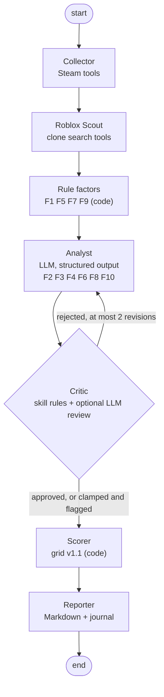

# steam-roblox-agents

## Résumé en français

Pipeline multi-agents LangGraph qui décide si un jeu Steam en tendance mérite une adaptation
Roblox : **prototyper**, **surveiller** ou **passer**. Un agent Collecte interroge les API
publiques Steam, un agent Roblox cherche les clones existants, un agent Analyste note six
facteurs qualitatifs par LLM (sortie structurée Pydantic, justification, confiance), un agent
Critique revérifie les notes avec des règles de cohérence et renvoie à l'Analyste au plus deux
fois, puis un nœud déterministe calcule le score et un nœud Rapport rédige la décision.

Points d'attention :

- **Traçabilité** : chaque décision garde ses sources (URL, outil, horodatage, live ou
  fixture) dans un journal JSONL, avec l'empreinte de chaque skill utilisée.
- **Skills réutilisables** : le dossier `skills/` contient des fichiers Markdown (barème, règles
  de cohérence, recherche de clones, format de rapport) chargés à la demande par chaque agent.
- **LLM interchangeable** : Gemini, Anthropic, OpenAI ou Ollama via `init_chat_model`. Les tests,
  la CI, la démo et l'évaluation tournent hors ligne avec un modèle scripté déterministe et des
  réponses API enregistrées : aucun appel payant.
- **Évaluation** sur 21 cas historiques (2020-2026) : exactitude du verdict, matrice de
  confusion, écart de score, reproductibilité sur N exécutions, stabilité sous bruit simulé,
  taux de validation du Critique. Ces cas ont servi à calibrer la grille : ce n'est pas une
  évaluation à l'aveugle.
- Résultat actuel : 81,0 % de verdicts exacts (95,2 % en lecture tolérante), sorties identiques
  sur 5 exécutions, 93,3 % d'accord de verdict sous bruit. L'évaluation a trouvé un vrai bug
  (faux positif de la règle F5 sur Lethal Company), corrigé avec un test de non-régression.

Lancer : `make install && make demo` (hors ligne), `make test`, `make eval`.

---

## What it does

Given a Steam app id, the pipeline collects Steam and Roblox data, scores ten factors and
returns a verdict with a Markdown decision record and a JSONL audit trail.



The compiled graph can be printed with `sra graph`.

| Node | Kind | Responsibility |
|---|---|---|
| `collector` | tool executor | Steam store item, tags, current players, SteamCharts history, review histogram |
| `roblox_scout` | tool executor | builds search queries from the `clone-search` skill, finds clones and established games |
| `rule_factors` | deterministic | F1 social play, F5 age rules, F7 momentum, F9 window, durable genre, saturation |
| `analyst` | LLM | scores F2, F3, F4, F6, F8, F10 with a justification and a confidence level |
| `critic` | rules + LLM | checks structure and skill-defined bounds, asks for a revision or clamps |
| `scorer` | deterministic | weights, bonus, malus, caps, timing decay, verdict |
| `reporter` | deterministic | decision record with factor table, critic log, sources, skill hashes |

## Why several agents

The split follows the kind of work, not a fashion for agents:

- **Judgement is isolated.** Only the Analyst and the Critic call an LLM. Data collection and
  arithmetic are code, so the non-reproducible part of the system is small and easy to audit.
- **A second check before the score.** The Critic is a separate role with its own skills. It
  catches answers that contradict the evidence (for example "easy to clone" for a game tagged
  Open World) and sends them back with the rule id. After two revisions it clamps the value to
  the bound and flags the candidate for a human, instead of looping.
- **Tool agents stay replaceable.** The Collector and the Scout expose plain typed tools; they
  run a fixed plan today and could be given to a tool-calling LLM later without touching the
  rest of the graph.
- **Typed contracts between nodes.** The state is a `TypedDict` of Pydantic models
  (`SteamSnapshot`, `RobloxSnapshot`, `FactorScore`, `CriticVerdict`, `ScoreBreakdown`). The
  Critic history and the list of skills used are append-only.

## Skills

`skills/` is a small library of Markdown files with YAML front matter. Each skill declares which
agents and tasks it applies to; agents select their skills at run time
(`SkillRegistry.select("critic", "review")`). The body goes into the prompt, the optional
`data:` block is used by code.

| Skill | Used by | Content |
|---|---|---|
| `scoring-rubric` | Analyst, Critic | 0 to 5 rubric for the six qualitative factors, output contract |
| `roblox-platform-rules` | Analyst | audience and policy constraints, lessons from past cases |
| `consistency-rules` | Critic | machine-checkable bounds (C1 to C5), revision and clamp policy |
| `clone-search` | Roblox Scout | tag and description keyword maps, clone definitions |
| `report-template` | Reporter | report structure and next-step wording per verdict |

Each decision in the journal records `name@version#hash` of the skills used, so a score can be
tied to the exact rubric that produced it. `sra skills` lists the library.

## Traceability

Every node appends events to `runs/<run_id>/journal.jsonl`. Data events carry their sources:

```json
{"node": "collector", "event": "steam_snapshot", "appid": 5335510,
 "data": {"name": "Moon Sweepers", "peak_ccu": 38917, "days_since_peak": 0, "...": "..."},
 "sources": [{"tool": "steam.current_players", "origin": "fixture", "fetched_at": "2026-11-08T13:43:11Z",
              "url": "https://api.steampowered.com/ISteamUserStats/GetNumberOfCurrentPlayers/v1/?appid=5335510"}]}
{"node": "critic", "event": "revision_requested", "appid": 5335510,
 "data": {"attempt": 1, "rule_ids": ["C1"], "skills": ["consistency-rules@1.0#6accf3ae"],
          "issues": ["[C1] F3=4 exceeds 2: complex systems (open world, MMO, creature AI) cannot be cloned quickly (tags: Open World)"]}}
```

The Analyst events also store the model name, a hash of the prompt and a hash of the raw answer.
Each factor in the final report shows its origin (`rule`, `llm` or `critic-clamp`) and its
confidence.

## Evaluation

`eval/cases.yaml` holds 21 Steam games that trended between 2020 and 2026 and what happened on
Roblox afterwards (success, mixed, failure), from a research note written for the original
project. Expected verdicts: success -> prototype, mixed -> watch, failure -> pass.

**Honest caveat.** These 21 cases were used to set the grid weights, bonus and malus (v1.0 ->
v1.1). This is a consistency and reproducibility test, not a blind measure of predictive power.
A real validation needs games scored before their Roblox outcome is known.

How the offline evaluation works:

1. The Steam store data of each game (tags, categories, content descriptors) is the real
   response of the Steam API, recorded once. The context at the Steam peak (peak players,
   price at the time, whether Roblox already had a leader in that genre) comes from the case file.
2. The Analyst is the scripted model; its answers are the hand-assigned reference scores of the
   study. The rule factors are recomputed by the pipeline from the recorded data, so the
   pipeline score can differ from the reference score.
3. Five noise-free runs check determinism. Five more runs add simulated sampling noise: each
   Analyst score moves by +-1 with probability 0.2 (seeded), to measure how stable the verdicts
   are when the model wavers, and how often the Critic catches it.

Results (`make eval`, full report in [`eval/results/report.md`](eval/results/report.md)):

| Metric | Pipeline | Reference scores through the grid |
|---|---|---|
| Strict accuracy (verdict == expected) | 81.0% | 85.7% |
| Lenient accuracy (no success dropped, no failure kept) | 95.2% | 100.0% |
| Score MAE vs reference score | 5.1 | 0 |
| Identical outputs over 5 noise-free runs | yes | |
| Mean verdict agreement under noise (p=0.2, 5 seeds) | 93.3% (16/21 cases fully stable) | |
| Strict accuracy under noise, per run | 71.4%, 81.0%, 76.2%, 81.0%, 66.7% | |
| Critic first-pass approval / final validation (noise-free) | 85.7% / 85.7% | |
| Critic clamp rate and human-review rate (noise-free) | 14.3% | |

Confusion matrix (noise-free, rows = expected):

| expected \ predicted | prototype | watch | pass |
|---|---|---|---|
| prototype | 8 | 1 | 0 |
| watch | 0 | 3 | 2 |
| pass | 0 | 1 | 6 |

What the misses say:

- **Vampire Survivors** (failure, predicted watch): Steam now lists local co-op, added after the
  2022 peak, so the rule gives F1 = 4 instead of 0. Metadata recorded today does not always
  describe the game at its peak.
- **Among Us** (success, predicted watch): the saturation malus fires because social deduction
  was already on Roblox; the study's own score has the same miss.
- **Only Up!** and **Escape from Tarkov** (mixed, predicted pass): the study's reference scores
  also give pass. For Tarkov the Critic rule C5 raised F2 because Steam tags the game "Survival
  Horror"; the candidate was flagged for human review, which is the intended behaviour.
- **Found and fixed through the evaluation:** the first run gave 76.2%. Lethal Company, a clear
  Roblox success, was capped at 30 because its content notes mention "fictional medical drugs"
  and the F5 rule matched any occurrence of "drug". The rule now looks for illegal drugs,
  dealing or trafficking; a regression test pins the case (see the git history).

CI re-runs the evaluation and fails if the fresh `metrics.json` differs from the committed one.

## Running it

Requirements: Python 3.11 or later. No API key is needed for the default mode.

```bash
make install        # .venv + package + dev tools
make demo           # offline: recorded Steam/Roblox responses + scripted model
make test           # pytest with coverage gate (80%)
make eval           # writes eval/results/report.md and metrics.json
make lint typecheck # ruff + mypy
```

The demo scores three games that were trending on 2026-11-08 (Moon Sweepers, ZED ZONE, Planet
Zoo 2) and writes one report per game plus the journal in `runs/<run_id>/`. Its scripted
Analyst answers are hand-written stand-ins for a model (`fixtures/llm/demo.json`); the first
answer for Moon Sweepers breaks rule C1 on purpose, so the demo shows a Critic revision.

### Real mode

Set a provider and let the HTTP client go live. Example with the Gemini free tier:

```bash
pip install -e ".[google]"
export SRA_LLM_PROVIDER=google GOOGLE_API_KEY=...   # default model gemini-2.5-flash
export SRA_HTTP_MODE=live                           # or "record" to save fixtures as well
sra run 3527290 3241660
```

Other providers: `anthropic` (`ANTHROPIC_API_KEY`), `openai` (`OPENAI_API_KEY`), `ollama` (local,
no key; `docker compose` file included). `SRA_LLM_MODEL` overrides the default model,
`SRA_MAX_REVISIONS` the Critic budget, `SRA_CRITIC_LLM=false` disables the LLM review. With a
real provider the Analyst uses native structured output (`with_structured_output`); the scripted
model goes through JSON parsing with one retry on validation errors. See `.env.example`.

### Docker

```bash
docker build -t steam-roblox-agents .
docker run --rm steam-roblox-agents demo
docker run --rm steam-roblox-agents eval
```

## Repository layout

```
src/sra/
  graph.py            LangGraph wiring, run_candidate()
  state.py            typed state and Pydantic contracts
  agents/             collectors.py, rules.py, analyst.py, critic.py, output.py
  sources/            http.py (live/record/replay), steam.py, roblox.py
  grid.py features.py deterministic scoring grid and rule factors
  skills.py           skill registry
  llm.py              provider factory, scripted model, structured invocation
  trace.py            JSONL journal
  evaluation.py       offline evaluation
  cli.py              sra demo | run | record | eval | graph | skills
skills/               Markdown skills loaded by the agents
fixtures/             recorded HTTP responses, scripted demo answers
eval/                 historical cases and generated results
docs/grid.md          grid specification and calibration history
tests/                124 tests, 98% line coverage
```

## Limits

- The evaluation set is small (21 cases) and was used for calibration. It says the pipeline is
  consistent and reproducible, not that it predicts well.
- The offline Analyst replays human scores. The numbers above do not measure how well a given
  LLM scores the qualitative factors; running the evaluation with a real provider is the next
  step, and its stability would then come from the model, not from simulated noise.
- Steam metadata drifts (Vampire Survivors). Historical context in the case file is
  reconstructed from public sources and partly uncertain (Roblox peaks before 2022 are unknown).
- Roblox player counts are live snapshots from a public mirror, not historical peaks.
- The Collector and Scout follow a fixed plan; they do not choose tools dynamically.
- Rule F5 relies on Steam descriptors and keywords; it can over-penalise (Chained Together gets
  F5 = 2 from its gore descriptor).

## Origin

This repository rebuilds, as a typed multi-agent pipeline, a scoring cron I wrote first as plain
scripts. The grid, the rule factors and the historical study come from that project; the graph,
Critic loop, skill library, traceability and evaluation harness are new.

License: MIT.
